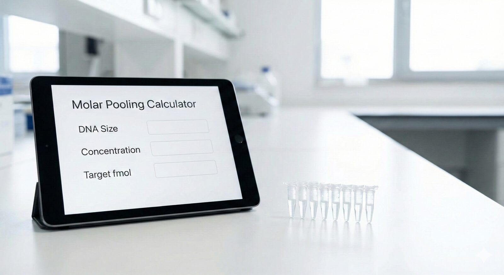

## The Problem: Mass ≠ Molecules

In the laboratory, we are often taught to quantify DNA in nanograms (ng). However, for biological reactions like **Next-Generation Sequencing (NGS)**, **Gibson Assembly**, or **PCR pooling**, the weight of the DNA matters much less than the **number of molecules**.

If you mix a 500bp amplicon and a 2000bp amplicon at the same mass (e.g., 50ng each), you actually have **4 times more molecules** of the small fragment. This imbalance can ruin sequencing libraries or lower cloning efficiency.

## The Solution

I developed the **DNA Molar Pooling Calculator** to solve this. It is an R Shiny application that automates the physics of DNA normalization. By calculating based on **molarity (fmol)** rather than mass, it ensures perfectly balanced pools regardless of fragment size.

### Key Features

-   **Universal:** Works for Nanopore, Illumina, PacBio, or standard cloning vectors.
-   **Batch Mode:** You can paste data directly from Excel (Sample Name, Conc1, Conc2...) to process entire plates at once.
-   **Safety Checks:** The app automatically flags samples (in red) that are too dilute to meet your target concentration.

## 🚀 Live Calculator

You can use the tool directly below, or open it in a [new window](https://danielsangarci.shinyapps.io/dna-molar-pooling-calculator/).

```{=html}
<!-- La app solo se carga al pulsar el boton: asi no se despierta en
     shinyapps.io con cada visita (ahorra horas del plan gratuito y la
     pagina carga al instante). El script esta en posts/_app-lanzador.html. -->
<div class="app-lanzador" data-src="https://danielsangarci.shinyapps.io/dna-molar-pooling-calculator/" data-height="1250px">
  
  <div class="app-lanzador__capa">
    <button type="button" class="btn btn-primary app-lanzador__boton"><i class="bi bi-play-fill" aria-hidden="true"></i> Launch app</button>
    <p class="app-lanzador__nota">The app may take a few seconds to start.</p>
  </div>
</div>
```